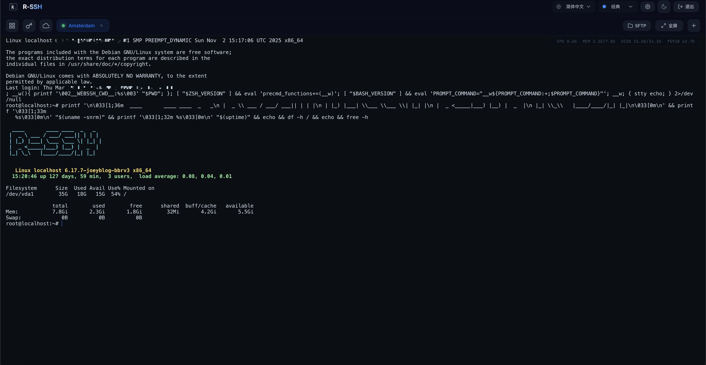
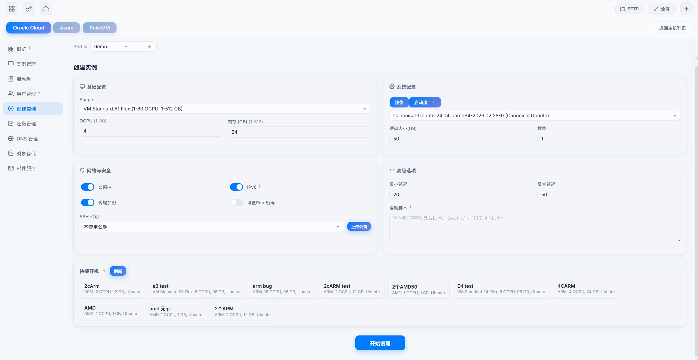
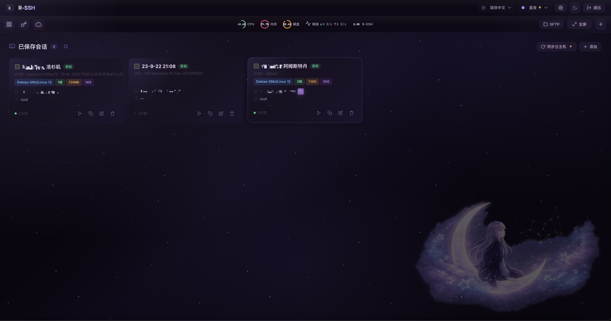
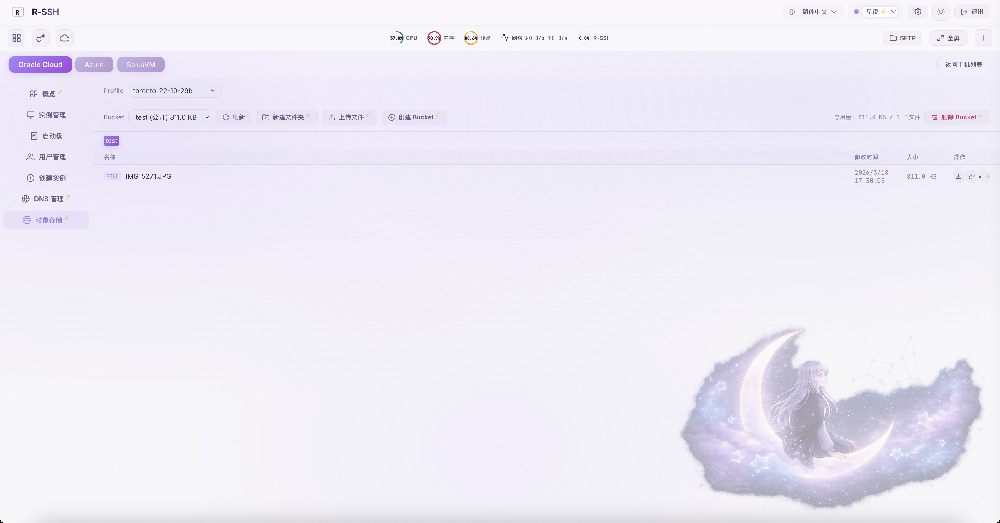

# <p align="left">R-Bot ⭐</p>

简体中文 | [English](md/en/README.md)

<p align="left">
  <a href="https://t.me/apchyo"></a>
  <a href="https://t.me/agentONE_R"></a>
  <a href="https://t.me/radiance_helper_bot"></a>
  
</p>

## 概述

R-Bot 是一套**双端架构**的多云基础设施管理系统，通过 Telegram 机器人驱动本地客户端，快速管理 Oracle Cloud (OCI)、AWS、GCP、Azure、DigitalOcean、SolusVM、VirtFusion 等云平台资源。客户端同时内置了完整的 **Web SSH 终端** 和 **Web 云管理面板**，在浏览器中即可完成服务器运维和云资源管理。

### 核心特性

| 特性 | 说明 |
|------|------|
| **双端安全架构** | API 私钥仅存储在本地客户端，机器人不存储任何敏感数据 |
| **Telegram 机器人管理** | 30+ 云操作：开机、IP 管理、磁盘、监控等 |
| **Web SSH 智能终端** | 主机面板 + 终端工作区，多标签页、SFTP 文件管理、端口转发、多密钥智能匹配连接 |
| **Web 云管理面板** | 浏览器内管理实例、网络、卷、用户、DNS、对象存储、串行控制台等 |
| **多云支持** | Oracle Cloud、AWS、GCP、Azure、DigitalOcean、SolusVM、VirtFusion |
| **Cloudflare 集成** | 域名解析管理、SSL 证书自动签发、换 IP 自动更新解析 |
| **MCP 接入** | 让 Claude Code、Codex、Cursor 通过面板操作你授权的服务器，密码和私钥不交给 AI |
| **云监控与到期提醒** | 流量超额自动关停、实例停机自动拉起、域名与 SSL 证书临期 Telegram 提醒 |
| **云主机同步** | 一键从多云平台发现并同步主机到 SSH 会话列表 |
| **轻量** | 秒开，内存占用低，路由器上也能跑 |





---

## 快速开始

### 1. 关注频道和机器人

- [Telegram 频道](https://t.me/agentONE_R) — 版本更新通知
- [Telegram 机器人](https://t.me/radiance_helper_bot) — 获取凭据和操作面板

### 2. 一键安装

```bash
wget -O sh_client_bot.sh https://github.com/semicons/java_oci_manage/releases/latest/download/sh_client_bot.sh && chmod +x sh_client_bot.sh && bash sh_client_bot.sh
```

> 建议先创建目录：`mkdir rbot && cd rbot`

### 3. 启动

```bash
bash sh_client_bot.sh
```

启动后访问 `https://你的IP:9527`。

### 4. 激活客户端

首次启动会自动生成凭据，页面顶部会显示激活提示。两种方式完成激活：

- **方式一**：复制页面提示的 `/bindclient` 命令，发送给 [Telegram 机器人](https://t.me/radiance_helper_bot) 完成绑定
- **方式二**：如已有账户，可以在页面顶部红色激活提示栏里点击「已有账户？」按钮，或直接修改 `client_config` 里的 `username=` / `password=` 后重启

激活后即可添加云平台 API 参数开始使用。

详见 → [上手教程](md/quickstart.md) ｜ [安装与配置](md/install.md)

---

## 功能总览

### Telegram 机器人 — 云管理

通过 Telegram 机器人操作，支持 Oracle Cloud、AWS（EC2 / Lightsail）、GCP、Azure、DigitalOcean、SolusVM、VirtFusion。

- **实例管理** — 开机、升降配、重置系统、终止
- **IP 管理** — 换 IP、自动 DNS 更新、IPv6
- **磁盘管理** — 扩容、性能调优、分离/附加
- **监控告警** — 状态监控、自动换 IP、自动重启
- **账户管理** — 用户管理、API 密钥、2FA 重置、配额查询
- **面板类云支持** — DigitalOcean Droplet、SolusVM VPS、VirtFusion 实例的查询与基础电源操作

完整列表 → [已实现功能](md/function.md) ｜ [机器人命令说明](md/BOT-README.md)

### Web SSH 智能终端

通过浏览器访问，无需安装客户端软件。

- **SSH 连接** — 密码/私钥认证，多标签页，分屏、会话挂起、持久 Shell、断线自动重连，SOCKS5 代理
- **资源监控** — 顶栏实时显示 CPU、内存、硬盘、网络指标
- **SFTP 文件管理** — 浏览、上传、下载、删除、在线编辑（语法高亮）
- **端口转发** — 本地转发和远程转发
- **批量命令** — 向多个主机同时发送命令，结果工作台支持连续执行
- **终端贴图** — 网页终端里也能给 Claude Code、Codex 粘截图
- **资源告警** — CPU / 内存 / 磁盘阈值告警，Telegram 推送
- **多云体检** — 一屏汇总所有云平台实例状态与健康度
- **主机面板** — 卡片网格展示所有会话，搜索过滤、标签分组、快速连接
- **会话管理** — 保存连接配置，集中密钥管理
- **云主机同步** — 一键从 OCI/AWS EC2/AWS Lightsail/GCP/Azure/DO/SolusVM/VirtFusion 发现主机并导入会话列表
- **SSL 证书** — Let's Encrypt 证书自动签发和续期
- **对象存储** — OCI Object Storage 的 Bucket 和文件管理

详见 → [Web SSH 终端指南](md/webssh.md)



### Web 云管理面板

在浏览器中直接管理多云资源，与 Telegram 机器人操作能力对齐。

- **实例管理** — 创建实例、快捷开机、启动、关机、重启、终止、重装系统、升降配
- **快速配置开机** — AMD 微型 / ARM A1 一键预填参数，也可从现有启动盘直接开机
- **A1 配置体检** — 批量检查 ARM 是否超出免费额度并降回，不会自动删机器
- **串行控制台** — SSH 连不上时救机器，可进 Netboot.xyz 救援系统
- **网络管理** — 换 IP、附加 IPv4/IPv6、保留 IP 管理
- **硬盘管理** — 扩容、提升 IO、分离、挂回、删除
- **用户管理** — 创建用户、重置密码、修改邮箱、清除 2FA
- **统计概览** — 成本、流量、订阅信息、配额查询
- **DNS 管理** — Cloudflare 域名解析的增删改查
- **云监控** — 按账号设流量阈值超额自动关停、实例停机通知与自动拉起
- **域名监控** — 每日检查域名与 SSL 证书到期，分档 Telegram 提醒，可从 Cloudflare 一键导入
- **多账号** — 每个账号可以走自己的代理，账号配置可一键复制到新地区
- **客户端维护** — 网页上升级、重启客户端，查看日志
- **对象存储** — OCI Object Storage 的 Bucket 和文件管理
- **邮件服务** — 一键搭建发信域名和 SMTP 账号、测试发信
- **AWS 管理** — EC2 实例、防火墙和 IPv6，Lightsail 实例创建、管理、流量、换 IP、IPv6，费用统计
- **GCP 管理** — Compute Engine 实例创建/管理/删除、换 IP、概览统计、流量查询
- **DigitalOcean 管理** — Droplet 创建/管理、保留 IP、带宽监控、账单概览
- **Azure 管理** — VM 创建/删除/重启、换 IP、资源用量
- **SolusVM 管理** — VPS 开关机/重启、状态仪表盘
- **VirtFusion 管理** — 厂商分组实例列表、流量面板、SSH 快捷连接、开关机/重启、改名、重置密码

详见 → [Web 云管理面板指南](md/cloud.md)



---

## 文档导航

**教程 — 建议按顺序看**

| 教程 | 说明 |
|------|------|
| [上手教程](md/quickstart.md) | 从装客户端到开出第一台机器并连上去 |
| [甲骨文开机教程](md/boot-oracle.md) | 机器人端和 Web 端开机详解、抢机机制、失败排查 |
| [常用操作教程](md/howto.md) | 换 IP 更新 DNS、流量超额关机、A1 降配、域名监控、串口救援等 |
| [MCP 接入](md/mcp.md) | 让 AI 助手通过面板操作服务器：发令牌、配客户端、安全须知 |

**参考手册**

| 文档 | 说明 |
|------|------|
| [安装与配置](md/install.md) | 安装脚本、配置参数、启动命令 |
| [已实现功能](md/function.md) | 完整功能列表（机器人 + Web SSH + 云管理） |
| [机器人操作与命令](md/BOT-README.md) | Telegram 机器人指令和键盘菜单说明 |
| [Web SSH 终端指南](md/webssh.md) | Web SSH 终端功能详解 |
| [Web 云管理面板指南](md/cloud.md) | Web 云管理面板功能详解 |
| [甲骨文云 API 配置](md/oracle.md) | 获取和上传 OCI API 参数 |
| [Azure API 配置](md/azure.md) | 获取和上传 Azure API 参数 |
| [常见问题](https://t.me/agentONE_R/41) | Telegram 频道置顶 FAQ |

---

## 常用命令

```bash
# 启动 / 重启（守护进程模式）
bash sh_client_bot.sh

# 指定端口启动
bash sh_client_bot.sh 8888

# 查看状态
bash sh_client_bot.sh status

# 查看日志（Ctrl+C 退出）
bash sh_client_bot.sh log

# 停止
bash sh_client_bot.sh stop

# 重启
bash sh_client_bot.sh restart

# 升级
bash sh_client_bot.sh upgrade

# 卸载
bash sh_client_bot.sh uninstall
```

---

## 工作方式

```
你 → Telegram 机器人 → 你自己的客户端 → 各家云
你 → 浏览器 ────────→ 你自己的客户端 → 各家云
```

- 客户端装在你自己的服务器上，云平台的 API 私钥只存在这里
- 机器人只负责把你的指令转给客户端，不保存任何密钥
- 不想用了，停掉客户端即可

---

## 支持的平台

| 客户端架构 | 下载包 |
|-----------|--------|
| Linux x86_64（AVX2） | `gz_client_bot_x86.tar.gz` |
| Linux x86_64（兼容） | `gz_client_bot_x86_compatible.tar.gz` |
| Linux ARM64 | `gz_client_bot_aarch.tar.gz` |
| macOS ARM64（Apple Silicon） | `gz_client_bot_mac_aarch.tar.gz` |

> 启动脚本会自动检测架构并下载对应版本。

---

## 声明

> 本系统为双端架构，API 私钥存储在你的本地客户端服务器。机器人驱动客户端操作，你可以随时关闭服务。介意请勿使用。
>
> <details>
> <summary>完整免责条款</summary>
>
> 本仓库发布的项目中涉及的任何脚本，仅用于测试和学习研究，禁止用于商业用途，不能保证其合法性、准确性、完整性和有效性，请根据情况自行判断。
>
> 所有使用者在使用项目的任何部分时，需先遵守法律法规。对于一切使用不当所造成的后果，需自行承担。对任何脚本问题概不负责，包括但不限于由任何脚本错误导致的任何损失或损害。
>
> 如果任何单位或个人认为该项目可能涉嫌侵犯其权利，则应及时通知并提供身份证明、所有权证明，我们将在收到认证文件后删除相关文件。
>
> 任何以任何方式查看此项目的人或直接或间接使用该项目的任何脚本的使用者都应仔细阅读此声明。本人保留随时更改或补充此免责声明的权利。一旦使用并复制了任何相关脚本或本项目的规则，则视为您已接受此免责声明。
>
> 您必须在下载后的 24 小时内从计算机或手机中完全删除以上内容。您使用或者复制了本仓库且本人制作的任何脚本，则视为已接受此声明，请仔细阅读。
> </details>

---

## 更新日志

<details>
<summary>查看 Releases 说明</summary>

> 持续证明该项目仍然存活

</details>
