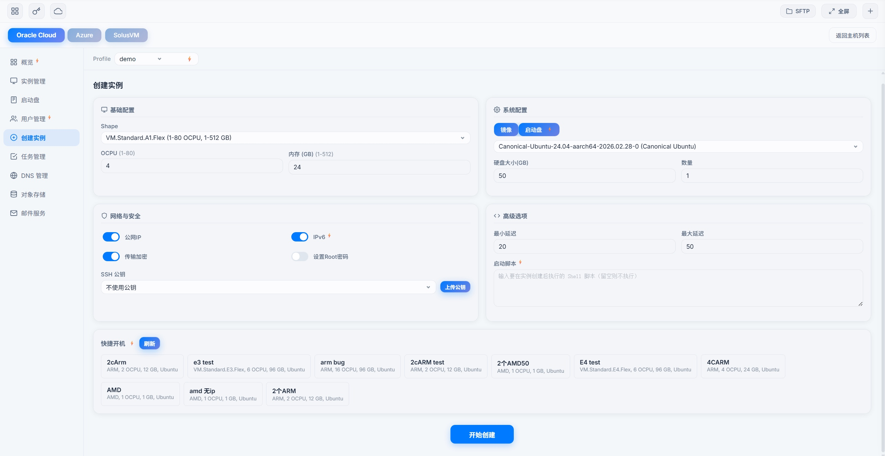

# Web 云管理面板指南

[English](./en/cloud.md)

在浏览器里管理 Oracle Cloud、AWS、GCP、Azure、DigitalOcean、SolusVM、VirtFusion 和 Cloudflare DNS，能做的事和 Telegram 机器人基本一致。

---

## 进入

访问 `https://你的IP:9527`，登录后切到「云管理」。

第一次用要先上传云平台的 API 配置：顶部「设置 → 配置文件设置」，或者直接改 `client_config`，见 [安装与配置](./install.md)。

---

## 概览

当前账号的基本情况：

| 卡片 | 内容 |
|------|------|
| **成本** | 近 3 个月花费 |
| **流量** | 近 3 个月流量 |
| **订阅** | 订阅类型、付费方式、有效期 |
| **配额** | 实例、网络、存储配额用了多少 |

多个账号可以切换 Profile 分别查看。

---

## Oracle Cloud

### 实例管理

| 操作 | 说明 |
|------|------|
| 实例列表 | 所有实例及状态，附带启动盘信息 |
| 创建实例 | 选规格、系统、网络等参数开机，详见 [甲骨文开机教程](./boot-oracle.md) |
| 快速配置 | 一键填好 AMD 微型 1C/1G 或 ARM A1 2C/12G 的全套参数 |
| 从启动盘创建 | 用一块现有的启动盘开机，原来的系统和数据都在；一次只能开一台，且只能开在这块盘所在的可用域 |
| 强开 ARM | 试用期账户提高 ARM 开机成功率（会短暂使用账户收费功能，风险自担） |
| 快捷开机 | 用机器人端保存过的开机配置一键填表 |
| 查看创建结果 | 提交后页面上会显示最终结果，同时也发 Telegram |
| 启动 / 关机 / 重启 | 基础操作 |
| 终止实例 | 删除实例，可以选择保留启动盘 |
| 重装系统 | 恢复成初始系统 |
| 升降配 | 调整 CPU 和内存 |
| 修改名称 | 改实例显示名 |
| 修复实例 | 实例异常时尝试诊断并重启修复 |

### 网络 / IP

| 操作 | 说明 |
|------|------|
| 网卡列表 | 网卡、内网 IP、公网 IP |
| 换 IPv4 | 换公网 IPv4 |
| 换 IPv6 | 换 IPv6 |
| 删除 IP | 删除公网 IP 或 IPv6 |
| 附加 IPv4 | 给实例多加一个 IPv4 |
| 附加 IPv6 | 新建一个 IPv6 |
| 附加保留 IP | 挂上预留的公网 IP |

### 卷管理

| 操作 | 说明 |
|------|------|
| 卷列表 | 所有硬盘，标明是否已附加到实例 |
| 调整容量 | 只能加大，不能缩小 |
| 调整 VPU | 提升硬盘 IO 速度 |
| 批量 VPU | 一键把所有硬盘的 VPU 拉满 |
| 分离卷 | 把硬盘从实例上卸下来，实例要先关机 |
| 附加启动盘 | 把卸下来的启动盘挂回实例，实例要先关机 |
| 删除卷 | 永久删除 |

卸下来的启动盘都在「未附加启动盘」面板里。实例没挂启动盘时，点「启动盘」会直接带你到那个面板。

### A1 配置体检 / 降配

甲骨文 ARM 免费额度是按账号算的，超开的账号有被回收的风险。这里可以批量检查并降回免费额度。

| 操作 | 说明 |
|------|------|
| 配置体检 | 查各账号的 ARM 用量，对比免费额度（2 核 12G），标出「超开 / 已符合额度 / 查询失败」 |
| 账号降配 | 设一个目标配置（默认 2 核 12G），在该账号的几台实例间平均分 |
| 批量降配 | 全选可降配的账号一次提交 |
| 逐台降配 | 单台实例单独降 |
| 删除实例 | 逐台确认删除，不提供批量删 |

降配时碰到容量不足会自动重试直到成功，结果发 Telegram，可以在任务列表里取消。只降不升，**不会自动删实例**。运行中的实例降配时会重启。

非闪电用户只能体检当前账号，闪电用户可以一次处理全部账号。

### 用户管理

| 操作 | 说明 |
|------|------|
| 用户列表 | 租户下所有用户 |
| 创建用户 | 新建管理员 |
| 修改邮箱 | 改用户邮箱 |
| 重置密码 | 可以让系统生成一个强密码 |
| 清除 MFA | 清掉用户绑定的所有两步验证设备 |
| 修改租户名 | 改租户显示名 |
| 删除用户 | 删除指定用户 |
| 密码策略 | 查看密码有效期、复杂度要求 |

部分操作需要 API 用户有「身份域管理员」角色。提示「操作需要身份域管理员权限」时，到 OCI 控制台「身份与安全 → 域 → Default 域 → 安全 → 管理员」给这个 API 用户加上这个角色，再重试。

### 对象存储

| 操作 | 说明 |
|------|------|
| 浏览 Bucket | 列出所有存储桶 |
| 浏览文件 | 按前缀筛选、分页 |
| 上传 / 下载 | 上传和下载文件 |
| 删除文件 | 删除单个文件 |
| 新建文件夹 | 创建目录 |

### Profile 管理

| 操作 | 说明 |
|------|------|
| Profile 列表 | 所有甲骨文账号，标明哪些配了 API 出站代理 |
| 切换 Profile | 切到另一个账号操作 |
| 复制为新地区 | 把现有账号复制一份，只改地区，省得重新填 API |
| API 出站代理 | 给某个账号单独配代理，详见 [常用操作教程](./howto.md#给每个账号配独立出站-ip) |
| 删除 Profile | 删除不要的账号配置 |

### 邮件服务（Email Delivery）

| 操作 | 说明 |
|------|------|
| 一键搭建 | 填域名和发件地址，自动建好邮件域、DKIM、DNS 记录、发件人和 SMTP 账号 |
| DNS 配置方式 | 域名在 Cloudflare 上的可以自动配；不在的会列出 DNS 记录让你手动添加，加好再继续 |
| 搭建进度 | 有进度条，离开页面回来还能接着看 |
| 域名列表 | 邮件域和 DKIM 验证状态 |
| DKIM 信息 | 查看 DKIM 记录，手动配置 DNS 时照着填 |
| DKIM 修复 | DKIM 验证不过时，通过 Cloudflare 重新配置 |
| 发件人 | 查看、添加发件地址 |
| SMTP 配置 | 查看服务器、端口、用户名 |
| 重新生成密码 | SMTP 密码只显示一次，注意保存 |
| 测试发信 | 自定义收件人、主题、内容发一封试试 |
| 删除域 | 删除邮件域及其发件人等配置 |

### 串行控制台

SSH 连不上时的救命通道。

| 操作 | 说明 |
|------|------|
| 连接控制台 | 一键连接，浏览器里直接出终端 |
| Netboot.xyz 救援 | 系统起不来时自动引导进救援系统 |
| 危险操作确认 | 关键步骤前会停下来等你确认 |

---

## AWS

### EC2 实例

| 操作 | 说明 |
|------|------|
| 实例列表 | 所有 EC2 实例及状态 |
| 创建实例 | 选系统镜像、机型、SSH 密钥，可勾选「分配 IPv6」，创建后显示进度 |
| 启动 / 停止 / 重启 | 基础操作 |
| 终止实例 | 永久删除 |
| 添加 IPv6 | 实例卡片 →「换IP」→「添加 IPv6」。网络还没开通 IPv6 时会自动开通，安全组里对所有 IPv4 开放的规则也会对所有 IPv6 开放。部分系统要重启实例才看得到新地址 |

### EC2 防火墙 / 安全组

EC2 实例卡片上的「防火墙」按钮，一个弹窗里管完安全组和规则。

| 操作 | 说明 |
|------|------|
| 查看安全组 | 已挂在这台实例上的，和同一网络里其他可用的 |
| 挂载 / 卸载 | 给实例挂上或摘掉安全组，至少要留一个 |
| 新建并挂载 | 新建一个安全组直接挂上 |
| 删除安全组 | 没有被任何实例使用时才能删 |
| 入站 / 出站规则 | 添加、删除规则，可选协议、端口范围、IPv4 / IPv6 地址段 |
| 常用规则 | SSH 22、HTTP 80、HTTPS 443、Ping、全部放行，点一下自动填好 |

入站规则删光了，SSH 也会连不上；出站规则删光了，服务器上不了网。

### Lightsail 轻量实例

| 操作 | 说明 |
|------|------|
| 实例列表 | IP、套餐、系统、规格、区域、创建时间 |
| 创建实例 | 在 AWS 创建页切到 Lightsail，选区域、可用区、系统、套餐、密钥、名称和数量，可选是否「启用 IPv6」。已保存的公钥可以直接用。完成后显示实例和 IP，同时发 Telegram。标着「仅 IPv6」的套餐没有公网 IPv4，你的网络和面板所在的网络都要支持 IPv6 才连得上 |
| 启动 / 关机 / 重启 | 基础操作 |
| 删除实例 | 需要确认 |
| 本月流量 | 入站、出站、合计和套餐额度。仅供参考，不等于账单用量 |

### Lightsail 网络 / IP

| 操作 | 说明 |
|------|------|
| 静态 IP | 创建并绑定、解绑、释放 |
| 换静态 IP | 换一个新的静态 IP，旧的自动释放 |
| 重启换 IP | 没绑静态 IP 的实例，关机再开机换一个公网 IP |
| 防火墙端口 | 查看和修改开放的端口，支持端口段。开启了 IPv6 的实例，规则同时对 IPv6 生效 |
| IPv6 | 实例卡片上「开启」或「关闭」。关闭会收回当前 IPv6 地址，再开启分到的是新地址 |

### 其他

| 操作 | 说明 |
|------|------|
| VPC | 查看和管理网络 |
| 费用统计 | 费用明细 |
| 监控指标 | 实例的监控数据 |
| 配额 | 资源配额用量 |

---

## GCP

| 操作 | 说明 |
|------|------|
| 实例列表 | 所有可用区的实例及状态 |
| 创建实例 | 选可用区、机型、系统、硬盘大小，会提示哪些是免费档 |
| 启动 / 停止 / 重启 | 基础操作 |
| 删除实例 | 删除完成后 Telegram 通知 |
| 换 IP | 换公网 IP |
| 概览 | 实例数量、可用区分布、免费档 e2-micro 用了几台 |
| 流量 | 近 3 个月流量 |

---

## Cloudflare DNS

| 操作 | 说明 |
|------|------|
| 域名列表 | Cloudflare 上托管的所有域名 |
| 解析记录 | 查看、添加、修改、删除 A / AAAA / CNAME 等记录 |

---

## DigitalOcean

| 操作 | 说明 |
|------|------|
| Droplet 列表 | 所有 Droplet 及状态、IP、规格 |
| 创建 Droplet | 选系统、区域、规格、SSH 密钥，可批量创建，可填开机脚本 |
| 开机 / 关机 / 重启 | 基础操作 |
| 保留 IP | 分配、绑定、解绑、释放 |
| 流量 | 实例卡片上直接显示当前周期流量（估算值） |
| 账单 | 账户余额、本月费用 |

---

## Azure

| 操作 | 说明 |
|------|------|
| 虚拟机列表 | 所有虚拟机及状态 |
| 创建 / 删除 / 重启 | 基础操作 |
| 换 IP | 换公网 IP |
| 资源用量 | 配额使用情况 |

---

## SolusVM

| 操作 | 说明 |
|------|------|
| VPS 列表 | 所有 VPS |
| 状态详情 | 单台 VPS 的状态 |
| 开机 / 关机 / 重启 | 基础操作 |

---

## VirtFusion

| 操作 | 说明 |
|------|------|
| 实例列表 | 按厂商分组，显示状态、IP、CPU、内存、硬盘、创建时间 |
| 流量 | 当前计费周期用了多少 |
| SSH 连接 | 一键跳到终端连接 |
| 开机 / 关机 / 重启 / 强制关机 | 电源操作 |
| 改名 | 在卡片上直接改 |
| 重置密码 | 新密码只显示一次 |
| 配置出错提示 | Token 失效或面板连不上时会提示，并可跳去重新配置 |

---

## 云监控

「云监控」标签页。和机器人端的实例监控是同一份设置，哪边改都一样。

### 流量守护

甲骨文免费流量每月 10240 GB，超了按量扣费。给账号设一个流量上限，到了就处理。

| 项目 | 说明 |
|------|------|
| 监控账号 | 每个账号单独设 |
| 流量阈值 | 单位 GB。甲骨文的流量数据有几小时延迟，建议填 9000，别贴着 10240 填 |
| 仅通知我 | 只发 Telegram，不动机器 |
| 自动关机 | 立刻关掉该账号**所有区域**的实例，不再二次确认 |

选自动关机前要知道：手动开回来如果流量还超着，1 小时内会再被关；关太久的话，A1 这种难开的机器可能被甲骨文收回，重开要重新抢。

### 停机保活

| 开关 | 说明 |
|------|------|
| 实例停机通知 | 机器意外停了发 Telegram |
| 停机自动开机 | 停了自动开回来。被流量守护关掉的账号当月不会自动开 |

---

## 域名监控

「域名监控」标签页。每天自动检查域名注册到期和 SSL 证书到期，快到期时发 Telegram。

| 操作 | 说明 |
|------|------|
| 添加域名 | 手动加一个 |
| 从 Cloudflare 导入 | 把 Cloudflare 上的域名一次导进来，已有的跳过 |
| 提醒开关 | 每个域名单独开关 |
| 立即检查 | 不等每天的定时检查，马上查一次 |
| 搜索 | 中文域名也能搜 |
| 删除 | 不再监控 |

到期前 30、14、7、1 天和过期当天各提醒一次。

填主域名（`example.com`），别填子域名，子域名查不到注册到期时间，会显示「未知」（证书到期照常能查）。

添加、导入、开启提醒需要闪电权益；停用、删除、查看、立即检查不需要。

---

## 设置

### 实例监控

| 功能 | 说明 |
|------|------|
| 实例监控通知 | 实例异常时发 Telegram |
| 监控自启 | 实例异常时自动尝试启动 |
| 每日报告 | 每天推送花费和流量 |
| 一键测活 | 批量检查所有账号是否正常 |
| 开机通知标注账号类型 | 开机成功通知里标明是升级号还是普通号，判断不准时不标 |

### 客户端升级与日志

在顶部设置菜单里，和机器人的「32. 升级客户端」「34. 查询最新日志」作用相同，不需要闪电权益。

**客户端升级**

| 操作 | 说明 |
|------|------|
| 版本检查 | 显示当前版本和最新版本 |
| 立即升级 | 下载新版并重启 |
| 强制升级 | 不管版本直接重装，版本检查失败时用这个 |
| 重启服务 | 只重启，不升级 |

5 分钟内只能触发一次升级或重启。升级时终端会断开，一般 1~3 分钟恢复。

**客户端日志**

直接在浏览器看客户端日志：可选显示 100 / 300 / 1000 行，能按关键字过滤、自动刷新、一键复制。出问题找客服时复制一段发过去很方便。

### SSL 证书

见 [Web SSH 终端指南 — SSL 证书配置](./webssh.md#ssl-证书配置)。

### 云平台配置

在网页上上传和修改各家云的 API 配置，不用登服务器改 `client_config`。

| 功能 | 说明 |
|------|------|
| 甲骨文 | 粘贴 API 配置，再上传 .pem 私钥文件，路径自动填好 |
| AWS | 粘贴 Access Key ID 和 Secret Access Key |
| GCP | 上传服务账号的 JSON 密钥文件 |
| DigitalOcean | 粘贴 API Token |
| Azure | 粘贴 appId / password / tenant |
| SolusVM | 粘贴 API 地址和密钥 |
| VirtFusion | 粘贴 host / token，常见厂商可以一键预填 |
| 同名跳过 | 上传的配置里有同名账号时自动跳过并提醒 |
| 在线编辑 | 已有的账号点开直接改 |
| 复制为新地区 | 甲骨文和 AWS 账号可以复制一份改个地区 |
| API 出站代理 | 在账号编辑面板底部设置；停用要点「移除代理」，清空输入框保存不算停用 |
| 删除账号 | 删除单个账号配置 |
| 密钥隐藏 | 密钥类字段只显示掩码 |
| AWS 区域纠错 | 区域填成可用区（比如 `ap-southeast-1a`）时会提示并一键改正 |
| Cloudflare | 填 API Token（推荐）或邮箱 + Global API Key |
| 网络配置 | 本机地址、URL 名称、启动模式 |
| 保存即生效 | 不用重启客户端 |

---

## 主题

8 种主题，每种都有亮色和暗色：

| 主题 | 风格 |
|------|------|
| 经典 | 默认蓝色 |
| 樱花 | 粉色系 |
| 赛博 | 霓虹青蓝 |
| 水墨 | 金色国风 |
| 极光 | 青绿紫渐变 |
| 星夜 | 深紫星空 |
| 海渊 | 深海蓝绿 |
| 日落 | 暖橘色 |

顶部栏切换主题和明暗模式。

---

## 一键 SSH

所有云的实例卡片上都有「SSH」按钮，点了直接连，不用填 IP。卡片上的 IP 也能一键复制。

---

## 多云体检

一个页面看所有云的实例总数、运行和停止数量、DNS 等信息。

---

## 在线客服

右下角的悬浮按钮打开客服聊天窗口，可以发图片。按钮会自动隐藏，也可以拖到别处。
