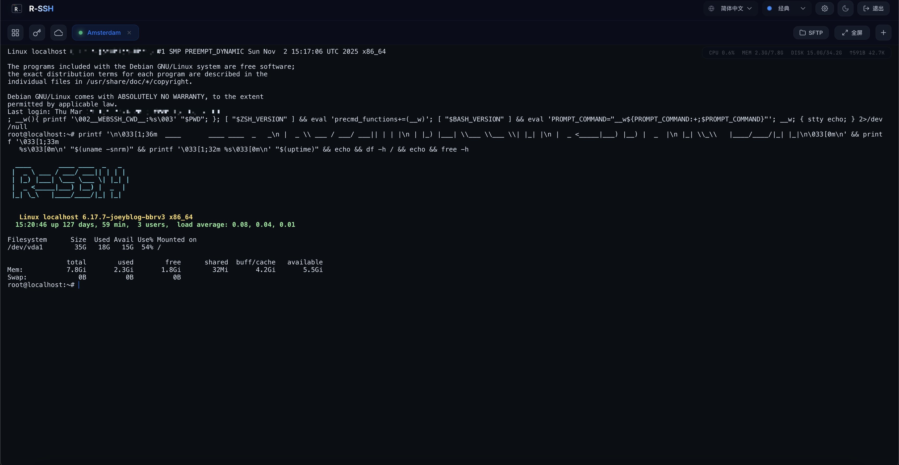
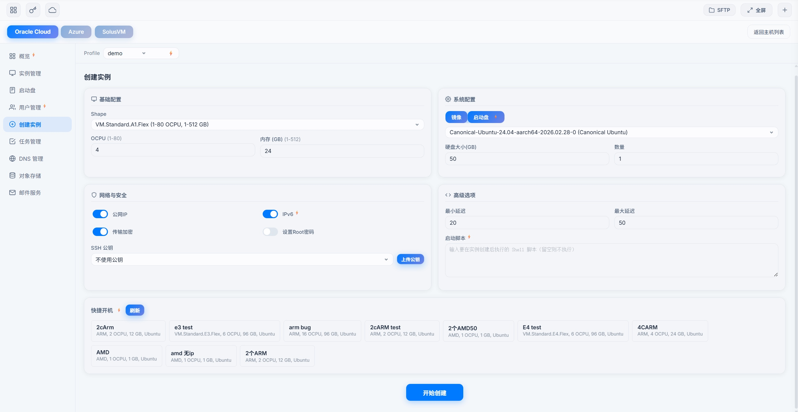
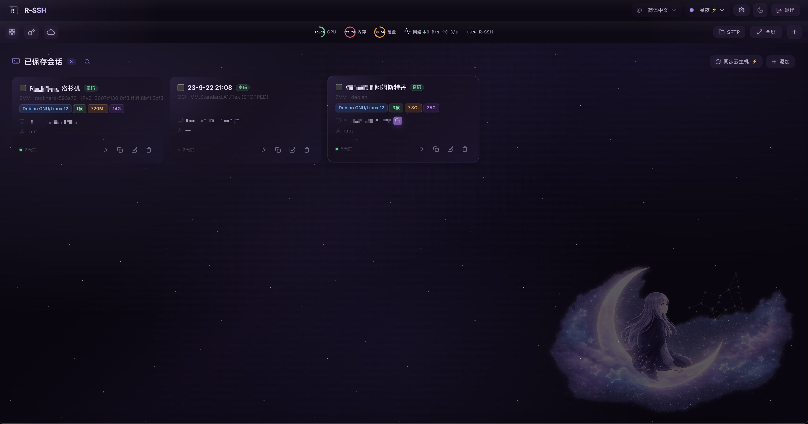
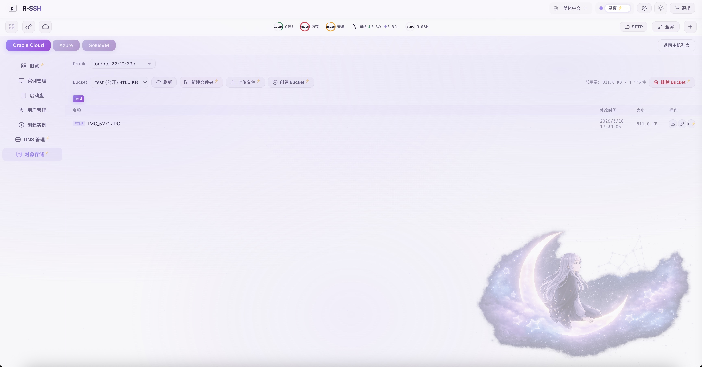

# R-Bot ⭐

[简体中文](../../README.md) | English

<p align="left">
  <a href="https://t.me/apchyo"></a>
  <a href="https://t.me/agentONE_R"></a>
  <a href="https://t.me/radiance_helper_bot"></a>
  
</p>

## Overview

R-Bot is a **dual-architecture** multi-cloud infrastructure management system that drives a local client through a Telegram bot for quick management of Oracle Cloud (OCI), AWS, GCP, Azure, DigitalOcean, SolusVM, VirtFusion, and more. The client also includes a built-in **Web SSH Terminal** and **Web Cloud Management Panel**, providing in-browser server operations and cloud resource management.

### Key Features

| Feature | Description |
|---------|-------------|
| **Dual-Architecture Security** | API private keys are stored only on your local client; the bot stores no sensitive data |
| **Telegram Bot Management** | 30+ cloud operations: boot instances, manage IPs, disks, monitoring, etc. |
| **Smart Web SSH Terminal** | Host dashboard + terminal workspace with multi-tab, SFTP, port forwarding, and smart multi-key auto-matching |
| **Web Cloud Management** | Manage instances, networks, volumes, users, DNS, object storage, serial console from your browser |
| **Multi-Cloud Support** | Oracle Cloud, AWS, GCP, Azure, DigitalOcean, SolusVM, VirtFusion |
| **Cloudflare Integration** | DNS management, automatic SSL certificates, DNS updated when the IP changes |
| **MCP Access** | Let Claude Code, Codex, and Cursor work on the servers you authorize through the panel, without handing over passwords or keys |
| **Cloud Monitoring & Expiry Alerts** | Auto-shutdown on traffic overage, auto-restart on unexpected stop, Telegram alerts before domains and certificates expire |
| **Cloud Host Sync** | One-click discover and sync hosts from multiple clouds to SSH session list |
| **Lightweight** | Starts in a second, low memory use, runs on routers too |





---

## Quick Start

### 1. Follow the Channel and Bot

- [Telegram Channel](https://t.me/agentONE_R) — Update notifications
- [Telegram Bot](https://t.me/radiance_helper_bot) — Get credentials and control panel

### 2. One-Click Install

```bash
wget -O sh_client_bot.sh https://github.com/semicons/java_oci_manage/releases/latest/download/sh_client_bot.sh && chmod +x sh_client_bot.sh && bash sh_client_bot.sh
```

> Recommended: create a directory first — `mkdir rbot && cd rbot`

### 3. Start

```bash
bash sh_client_bot.sh
```

After startup, visit `https://YOUR_IP:9527`.

### 4. Activate the Client

On first startup, credentials are auto-generated and an activation banner appears at the top of the page. Two ways to activate:

- **Option 1**: Copy the `/bindclient` command shown on the page and send it to the [Telegram Bot](https://t.me/radiance_helper_bot)
- **Option 2**: If you already have an account, click "Already have an account?" and enter your existing credentials

Once activated, add your cloud API parameters to start using the platform.

Details → [Getting Started](./quickstart.md) ｜ [Installation & Configuration](./install.md)

---

## Feature Overview

### Telegram Bot — Cloud Management

Operated through the Telegram bot, supporting Oracle Cloud, AWS (EC2 / Lightsail), GCP, Azure, DigitalOcean, SolusVM, and VirtFusion.

- **Instance Management** — Boot, scale up/down, reset OS, terminate
- **IP Management** — Change IP, auto DNS update, IPv6
- **Disk Management** — Resize, performance tuning, detach/attach
- **Monitoring & Alerts** — Status monitoring, auto IP change, auto-restart
- **Account Management** — User management, API keys, 2FA reset, quota queries
- **Panel-Based Clouds** — DigitalOcean Droplets, SolusVM VPS, and VirtFusion instances with list/detail and basic power actions

Full list → [Implemented Features](./function.md) ｜ [Bot Commands](./BOT-README.md)

### Smart Web SSH Terminal

Access through your browser — no client software required.

- **SSH Connections** — Password and private key auth, multi-tab, split-screen, session suspension, persistent shell, auto-reconnect, SOCKS5 proxy
- **Resource Monitor** — Real-time CPU, memory, disk, and network metrics in top bar
- **SFTP File Manager** — Browse, upload, download, delete, online edit (syntax highlighting)
- **Port Forwarding** — Local and remote forwarding
- **Batch Commands** — Send commands to multiple hosts simultaneously, result workbench with continuous execution
- **Terminal Image Paste** — Paste screenshots to Claude Code and Codex in the web terminal
- **Resource Alerts** — CPU / memory / disk threshold alerts pushed via Telegram
- **Multi-Cloud Health Check** — One-screen overview of instance status across all cloud platforms
- **Host Dashboard** — Card grid displaying all sessions with search, tag grouping, quick connect
- **Session Management** — Save connection profiles, centralized key management
- **Cloud Host Sync** — One-click discover hosts from OCI/AWS EC2/AWS Lightsail/GCP/Azure/DO/SolusVM/VirtFusion and import to session list
- **SSL Certificates** — Let's Encrypt certificates, issued and renewed automatically
- **OCI Object Storage** — Manage Buckets and objects in-browser

Details → [Web SSH Terminal Guide](./webssh.md)



### Web Cloud Management Panel

Manage multi-cloud resources directly from your browser — fully aligned with the Telegram bot's capabilities.

- **Instance Management** — Create instance, quick boot, start, stop, reboot, terminate, reset OS, scale up/down
- **Quick Config Launch** — One-click AMD Micro / ARM A1 presets, or boot straight from an existing boot volume
- **A1 Audit** — Find accounts over the ARM free allowance and bring them back, never deleting machines on its own
- **Serial Console** — Rescue machines you cannot SSH into, including a Netboot.xyz rescue system
- **Network Management** — Change IP, attach IPv4/IPv6, reserved IP management
- **Disk Management** — Grow, faster IO, detach, reattach, delete
- **User Management** — Create users, reset passwords, update email, clear 2FA
- **Statistics Overview** — Cost, traffic, subscription info, quota queries
- **DNS Management** — Add, edit, and delete Cloudflare DNS records
- **Cloud Monitoring** — Per-account traffic thresholds with automatic shutdown, plus stop notifications and auto-restart
- **Domain Monitoring** — Daily domain and SSL certificate expiry checks with tiered Telegram alerts, one-click Cloudflare import
- **Multiple Accounts** — Each account can use its own proxy; account configs can be copied to a new region in one click
- **Client Maintenance** — Upgrade and restart the client from the browser, read its logs
- **Object Storage** — OCI Object Storage bucket and file management
- **Email Delivery** — Set up a sending domain and SMTP account in one click, send a test
- **AWS Management** — EC2 instances, firewall, and IPv6; Lightsail creation, management, traffic, IP changes, and IPv6; costs
- **GCP Management** — Compute Engine instance create/manage/delete, change IP, overview stats, traffic query
- **DigitalOcean Management** — Droplet create/manage, reserved IP, bandwidth monitoring, billing overview
- **Azure Management** — VM create/delete/restart, change IP, resource usage
- **SolusVM Management** — VPS boot/shutdown/reboot, status dashboard
- **VirtFusion Management** — Vendor-grouped instance list, traffic panel, quick SSH, power actions, rename, password reset

Details → [Web Cloud Management Guide](./cloud.md)



---

## Documentation

**Tutorials — best read in order**

| Tutorial | Description |
|----------|-------------|
| [Getting Started](./quickstart.md) | From installing the client to launching your first instance and connecting to it |
| [Oracle Instance Launch Guide](./boot-oracle.md) | Launching from the bot and the web panel, how the capacity retry works, failure triage |
| [How-To Guide](./howto.md) | Rotate IPs with DNS updates, traffic-overage shutdown, A1 downscaling, domain monitoring, serial-console rescue |
| [MCP Access](./mcp.md) | Let AI assistants work on your servers through the panel: tokens, client setup, staying safe |

**Reference**

| Document | Description |
|----------|-------------|
| [Installation & Configuration](./install.md) | Install script, config parameters, startup commands |
| [Implemented Features](./function.md) | Full feature list (Bot + Web SSH + Cloud Management) |
| [Bot Commands](./BOT-README.md) | Telegram bot commands and keyboard menus |
| [Web SSH Terminal](./webssh.md) | Web SSH terminal feature guide |
| [Web Cloud Management](./cloud.md) | Web cloud management panel guide |
| [Oracle Cloud API Setup](./oracle.md) | How to get and upload OCI API parameters |
| [Azure API Setup](./azure.md) | How to get and upload Azure API parameters |
| [FAQ](https://t.me/agentONE_R/41) | Pinned FAQ in Telegram channel |

---

## Common Commands

```bash
# Start / Restart (daemon mode)
bash sh_client_bot.sh

# Start with custom port
bash sh_client_bot.sh 8888

# View status
bash sh_client_bot.sh status

# View logs (Ctrl+C to exit)
bash sh_client_bot.sh log

# Stop
bash sh_client_bot.sh stop

# Restart
bash sh_client_bot.sh restart

# Upgrade
bash sh_client_bot.sh upgrade

# Uninstall
bash sh_client_bot.sh uninstall
```

---

## How It Works

```
You → Telegram bot → your own client → your clouds
You → Browser ─────→ your own client → your clouds
```

- The client runs on your own server, and your cloud API keys are stored only there
- The bot just passes your commands to the client and keeps no keys
- Stop the client whenever you want out

---

## Supported Platforms

| Architecture | Package |
|-------------|---------|
| Linux x86_64 (AVX2) | `gz_client_bot_x86.tar.gz` |
| Linux x86_64 (compatible) | `gz_client_bot_x86_compatible.tar.gz` |
| Linux ARM64 | `gz_client_bot_aarch.tar.gz` |
| macOS ARM64 (Apple Silicon) | `gz_client_bot_mac_aarch.tar.gz` |

> The startup script auto-detects architecture and downloads the correct version.

---

## Disclaimer

> This system uses a dual-architecture design. API private keys are stored on your local client server. The bot drives your client operations, and you can shut down the service at any time. If you have concerns, please do not use this software.
>
> <details>
> <summary>Full Disclaimer</summary>
>
> Any scripts involved in the projects published in this repository are for testing and research purposes only. Commercial use is prohibited. We cannot guarantee their legality, accuracy, completeness, or validity. Please judge according to your situation.
>
> All users must comply with applicable laws and regulations when using any part of this project. Users bear all consequences of improper use. We are not responsible for any script issues, including but not limited to any losses or damages caused by script errors.
>
> If any entity or individual believes this project may infringe upon their rights, they should promptly notify us and provide identification and proof of ownership. We will remove relevant files upon receipt of certified documentation.
>
> Anyone who views or directly or indirectly uses any scripts from this project should carefully read this disclaimer. We reserve the right to modify or supplement this disclaimer at any time. By using or copying any related scripts or rules of this project, you are deemed to have accepted this disclaimer.
>
> You must completely delete the above content from your computer or phone within 24 hours of downloading. By using or copying any scripts made by us in this repository, you are deemed to have accepted this disclaimer. Please read carefully.
> </details>
