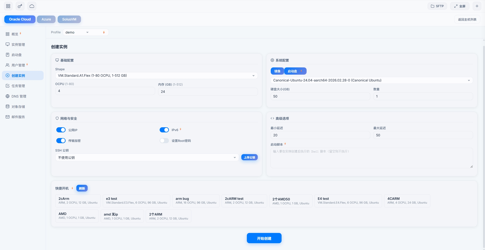

# Cloud Management Panel Guide

[简体中文](../cloud.md)

Manage Oracle Cloud, AWS, GCP, Azure, DigitalOcean, SolusVM, VirtFusion, and Cloudflare DNS in the browser. It covers much the same ground as the Telegram bot.

---

## Getting there

Go to `https://your-ip:9527`, sign in, and switch to "Cloud".

The first time, upload your cloud API configs: Settings → Config File Settings in the top bar, or edit `client_config` directly — see [Installation & Configuration](./install.md).

---

## Overview

The current account at a glance:

| Card | Content |
|------|------|
| **Cost** | Spending over the last 3 months |
| **Traffic** | Traffic over the last 3 months |
| **Subscription** | Type, payment method, validity |
| **Quota** | How much instance, network, and storage quota is used |

Switch profiles to look at other accounts.

---

## Oracle Cloud

### Instances

| Action | Notes |
|------|------|
| Instance list | Every instance and its state, with boot volume info |
| Create instance | Pick shape, OS, network and launch — see [Oracle Instance Launch Guide](./boot-oracle.md) |
| Quick config | Fill in the whole form for AMD Micro 1C/1G or ARM A1 2C/12G in one click |
| Create from boot volume | Launch from an existing boot volume, system and data intact; one instance at a time, and only in that volume's availability domain |
| Force ARM | Improves ARM launch success on trial accounts (briefly uses a paid feature — at your own risk) |
| Quick boot | Fill the form from a launch config saved on the bot |
| See the result | After submitting, the outcome is shown on the page and sent over Telegram |
| Start / stop / reboot | Basic actions |
| Terminate | Delete the instance, optionally keeping its boot volume |
| Reinstall | Back to the original OS image |
| Resize | Change CPU and memory |
| Rename | Change the display name |
| Repair | Diagnose and reboot a misbehaving instance |

### Network / IP

| Action | Notes |
|------|------|
| NIC list | NICs, private IPs, public IPs |
| Change IPv4 | Get a new public IPv4 |
| Change IPv6 | Get a new IPv6 |
| Delete IP | Remove a public IP or IPv6 |
| Attach IPv4 | Add another IPv4 to the instance |
| Attach IPv6 | Create a new IPv6 |
| Attach reserved IP | Attach a reserved public IP |

### Volumes

| Action | Notes |
|------|------|
| Volume list | Every disk, and whether it is attached to an instance |
| Resize | Grow only, never shrink |
| Adjust VPU | Faster disk IO |
| Batch VPU | Max out VPU on every disk at once |
| Detach | Take a disk off its instance. Stop the instance first |
| Attach boot volume | Put a detached boot volume back on an instance. Stop the instance first |
| Delete | Permanent |

Detached boot volumes live in the "Unattached Boot Volumes" panel. If an instance has no boot volume, clicking "Boot Volume" takes you straight there.

### A1 audit / downscale

Oracle's ARM free allowance is per account, and accounts over it risk having resources reclaimed. This checks accounts in bulk and brings them back within the allowance.

| Action | Notes |
|------|------|
| Audit | Check ARM usage per account against the free allowance (2 OCPU / 12 GB) and flag over-allowance, compliant, or query failed |
| Downscale account | Set a target (2 OCPU / 12 GB by default) and split it evenly across that account's instances |
| Batch downscale | Select every downscalable account and submit at once |
| Per instance | Downscale a single instance |
| Delete instance | One at a time with confirmation; no bulk delete |

Out-of-capacity errors during a downscale are retried until it succeeds; the result arrives over Telegram and the task can be cancelled from the task list. It only ever downscales and **never deletes an instance on its own**. Running instances reboot during the change.

Free users can audit the current account only; Lightning users can handle every account at once.

### Users

| Action | Notes |
|------|------|
| User list | Every user in the tenancy |
| Create user | Add an administrator |
| Change email | Update a user's email |
| Reset password | Optionally let the system generate a strong one |
| Clear MFA | Remove every two-factor device on a user |
| Rename tenancy | Change the tenancy display name |
| Delete user | Remove a user |
| Password policy | See expiry and complexity rules |

Some of these need the API user to hold the "Identity Domain Administrator" role. If you are told the operation requires Identity Domain administrator privileges, grant the role in the OCI console under Identity & Security → Domains → Default → Security → Administrators, then retry.

### Object Storage

| Action | Notes |
|------|------|
| Browse buckets | List every bucket |
| Browse files | Filter by prefix, paginate |
| Upload / download | Upload and download files |
| Delete file | Delete a single file |
| New folder | Create a folder |

### Profiles

| Action | Notes |
|------|------|
| Profile list | Every Oracle account, marking those with an API outbound proxy |
| Switch profile | Work on another account |
| Copy to region | Duplicate an account with a different region instead of re-entering the API details |
| API outbound proxy | Give one account its own proxy — see [How-To Guide](./howto.md#give-each-account-its-own-outbound-ip) |
| Delete profile | Remove an account's config |

### Email Delivery

| Action | Notes |
|------|------|
| One-click setup | Enter a domain and sender address; the email domain, DKIM, DNS records, sender, and SMTP account are all set up for you |
| DNS setup | Automatic for domains on Cloudflare; otherwise the records are listed for you to add by hand before continuing |
| Progress | Progress bar that survives leaving the page |
| Domain list | Email domains and DKIM status |
| DKIM info | The DKIM records, for adding by hand |
| DKIM repair | Reconfigure through Cloudflare when DKIM verification fails |
| Senders | View and add sender addresses |
| SMTP settings | Server, port, username |
| New password | The SMTP password is shown once — save it |
| Test send | Send a message with your own recipient, subject, and body |
| Delete domain | Remove the email domain and its senders |

### Serial console

The way in when SSH is not.

| Action | Notes |
|------|------|
| Connect | One click, and a terminal opens in the browser |
| Netboot.xyz rescue | Boots into a rescue system when the OS will not start |
| Confirmation | Pauses for you before anything risky |

---

## AWS

### EC2 instances

| Action | Notes |
|------|------|
| Instance list | Every EC2 instance and its state |
| Create instance | Pick image, type, SSH key, optionally tick "Assign IPv6"; progress is shown after creating |
| Start / stop / reboot | Basic actions |
| Terminate | Permanent |
| Add IPv6 | Instance card → "Change IP" → "Add IPv6". If the network has no IPv6 yet it is set up automatically, and security group rules open to all IPv4 are opened to all IPv6 too. Some systems only see the new address after a reboot |

### EC2 firewall / security groups

The "Firewall" button on an EC2 instance card manages groups and rules in one dialog.

| Action | Notes |
|------|------|
| View groups | Those on this instance, and others available in the same network |
| Attach / detach | Add or remove a group. At least one must stay |
| Create and attach | Make a new group and attach it right away |
| Delete group | Only when no instance is using it |
| Inbound / outbound rules | Add and remove rules by protocol, port range, and IPv4 / IPv6 range |
| Presets | SSH 22, HTTP 80, HTTPS 443, Ping, allow all — one click fills the form |

Remove every inbound rule and SSH stops working too; remove every outbound rule and the server loses internet access.

### Lightsail instances

| Action | Notes |
|------|------|
| Instance list | IP, bundle, OS, specs, region, creation time |
| Create instance | Switch the AWS creation page to Lightsail, then pick region, zone, OS, bundle, key, name, and count. Optionally "Enable IPv6". Saved public keys can be used directly. When done it shows the instances and IPs and sends a Telegram message. Bundles tagged "IPv6 only" have no public IPv4, so both your network and the panel's network must support IPv6 to connect |
| Start / stop / reboot | Basic actions |
| Delete | With confirmation |
| This month's traffic | In, out, total, and the bundle allowance. For reference only — not billed usage |

### Lightsail network / IP

| Action | Notes |
|------|------|
| Static IP | Create and attach, detach, release |
| Change static IP | Swap in a new static IP; the old one is released |
| Reboot for new IP | For instances without a static IP, stop and start to get a new public IP |
| Firewall ports | View and edit open ports, including ranges. On instances with IPv6, the rules apply to IPv6 too |
| IPv6 | "Enable" or "Disable" on the instance card. Disabling releases the current IPv6 address; enabling again gives a new one |

### Other

| Action | Notes |
|------|------|
| VPC | View and manage networks |
| Costs | Spending breakdown |
| Metrics | Instance monitoring data |
| Quotas | Resource quota usage |

---

## GCP

| Action | Notes |
|------|------|
| Instance list | Instances across every zone |
| Create instance | Pick zone, machine type, OS, disk size; free-tier options are marked |
| Start / stop / reboot | Basic actions |
| Delete | Telegram message when done |
| Change IP | Get a new public IP |
| Overview | Instance count, zone spread, how many free-tier e2-micro in use |
| Traffic | Last 3 months |

---

## Cloudflare DNS

| Action | Notes |
|------|------|
| Domain list | Every domain on Cloudflare |
| Records | View, add, edit, delete A / AAAA / CNAME and other records |

---

## DigitalOcean

| Action | Notes |
|------|------|
| Droplet list | Every Droplet with state, IP, size |
| Create Droplet | Pick OS, region, size, SSH key; batch creation and a startup script are supported |
| Power on / off / reboot | Basic actions |
| Reserved IPs | Assign, attach, detach, release |
| Traffic | Current-period traffic on each card (estimated) |
| Billing | Balance and this month's charges |

---

## Azure

| Action | Notes |
|------|------|
| VM list | Every VM and its state |
| Create / delete / restart | Basic actions |
| Change IP | Get a new public IP |
| Resource usage | Quota usage |

---

## SolusVM

| Action | Notes |
|------|------|
| VPS list | Every VPS |
| Status | Details for one VPS |
| Boot / shutdown / reboot | Basic actions |

---

## VirtFusion

| Action | Notes |
|------|------|
| Instance list | Grouped by vendor, with state, IP, CPU, memory, disk, creation time |
| Traffic | Usage in the current billing period |
| SSH | Jump straight into a terminal |
| Power on / off / reboot / force off | Power actions |
| Rename | Right on the card |
| Reset password | The new password is shown once |
| Config errors | Tells you when the token is invalid or the panel unreachable, with a link to fix it |

---

## Cloud monitoring

The "Cloud Monitoring" tab. It shares settings with the bot's instance monitoring — change either and both follow.

### Traffic guard

Oracle's free traffic is 10240 GB a month; beyond that you pay by usage. Set a limit per account and decide what happens when it is reached.

| Item | Notes |
|------|------|
| Account | Set per account |
| Threshold | In GB. Oracle's traffic figures lag by hours, so use 9000 rather than cutting it close at 10240 |
| Notify only | A Telegram message; instances untouched |
| Auto shutdown | Immediately stops that account's instances in **every region**, with no second confirmation |

Before choosing auto shutdown: if you start them again while still over, they are stopped again within the hour; and if they stay off too long, Oracle may take back hard-to-get A1 capacity, so you would be competing for it again.

### Uptime guard

| Toggle | Notes |
|------|------|
| Stop notifications | Telegram message when an instance stops unexpectedly |
| Auto-start | Start stopped instances again. Accounts shut down by traffic guard stay off for the rest of the month |

---

## Domain monitoring

The "Domain Monitoring" tab. Checks domain registration expiry and SSL certificate expiry every day and warns you over Telegram before they run out.

| Action | Notes |
|------|------|
| Add domain | Add one by hand |
| Import from Cloudflare | Pull in every domain on Cloudflare; ones already present are skipped |
| Reminder toggle | Per domain |
| Check now | Run a check immediately instead of waiting for the daily one |
| Search | Works with internationalized domains |
| Delete | Stop monitoring |

You get one reminder each at 30, 14, 7, and 1 day before expiry, and one on the day it expires.

Enter the main domain (`example.com`), not a subdomain. Subdomains have no registration date, so domain expiry shows "unknown" (certificate expiry still works).

Adding, importing, and turning on reminders need Lightning; disabling, deleting, viewing, and "Check now" do not.

---

## Settings

### Instance monitoring

| Feature | Notes |
|------|------|
| Instance alerts | Telegram message when an instance misbehaves |
| Auto-start | Try to start it again |
| Daily report | Spending and traffic every day |
| Health check | Check every account in one go |
| Account type in launch alerts | Launch notifications say whether the account is upgraded or regular; left out when unsure |

### Client upgrade and logs

In the settings menu. Same as the bot's "32. Upgrade Client" and "34. Latest Logs", and no Lightning needed.

**Upgrade**

| Action | Notes |
|------|------|
| Version check | Current and latest version |
| Upgrade now | Download the new version and restart |
| Force upgrade | Reinstall regardless of version — use it when the version check fails |
| Restart service | Restart without upgrading |

One upgrade or restart per 5 minutes. Terminals disconnect during an upgrade and are usually back within 1-3 minutes.

**Logs**

Read the client log in the browser: 100 / 300 / 1000 lines, keyword filter, auto-refresh, copy all. Handy for pasting a chunk to support when something goes wrong.

### SSL certificate

See [Web SSH Terminal Guide — SSL Certificates](./webssh.md#ssl-certificate-configuration).

### Cloud configs

Upload and edit your cloud API configs in the browser instead of logging into the server to edit `client_config`.

| Feature | Notes |
|------|------|
| Oracle | Paste the API config and upload the .pem key; the path is filled in for you |
| AWS | Paste the Access Key ID and Secret Access Key |
| GCP | Upload the service account JSON key |
| DigitalOcean | Paste the API token |
| Azure | Paste appId / password / tenant |
| SolusVM | Paste the API URL and keys |
| VirtFusion | Paste host / token; common vendors can be prefilled |
| Skip duplicates | Accounts with a name that already exists are skipped, with a notice |
| Edit online | Open an existing account and edit it in place |
| Copy to region | Duplicate an Oracle or AWS account with a different region |
| API outbound proxy | At the bottom of the account editor. To turn it off, click "Remove Proxy" — clearing the fields and saving does not |
| Delete account | Remove one account's config |
| Hidden secrets | Keys and tokens are shown masked |
| AWS region check | Warns and offers a fix when a zone (e.g. `ap-southeast-1a`) is entered as a region |
| Cloudflare | API token (recommended) or email + Global API Key |
| Network | Local address, URL name, startup mode |
| Takes effect on save | No client restart needed |

---

## Themes

Eight themes, each in light and dark:

| Theme | Style |
|------|------|
| Classic | Default blue |
| Sakura | Pink |
| Cyber | Neon cyan |
| Ink | Gold, Chinese ink |
| Aurora | Teal-green-purple gradient |
| Stellar | Deep purple night sky |
| Abyss | Deep-sea blue-green |
| Sunset | Warm orange |

Switch theme and light / dark in the top bar.

---

## One-click SSH

Every instance card on every cloud has an "SSH" button that connects without typing the IP. The IP can be copied with one click as well.

---

## Multi-cloud overview

One page with instance totals, running and stopped counts, DNS details, and more across every cloud.

---

## Support chat

The floating button in the bottom-right opens a chat with support; you can send images. The button hides itself and can be dragged out of the way.
