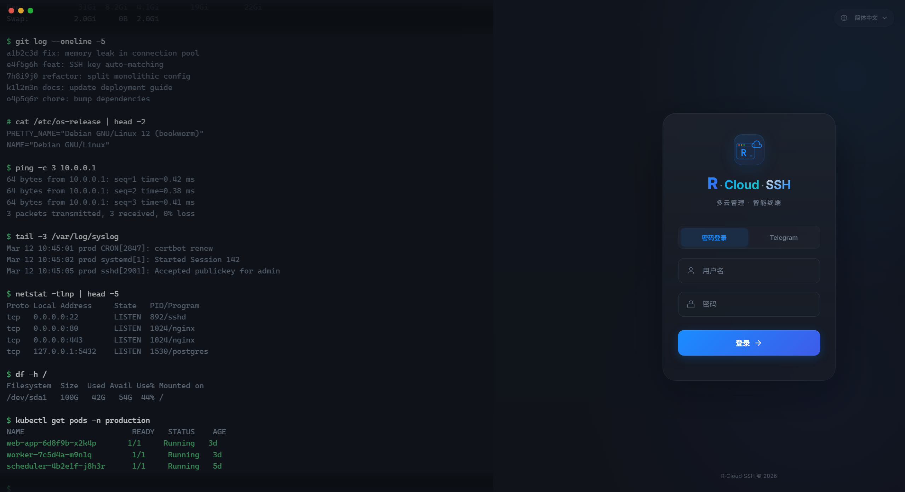
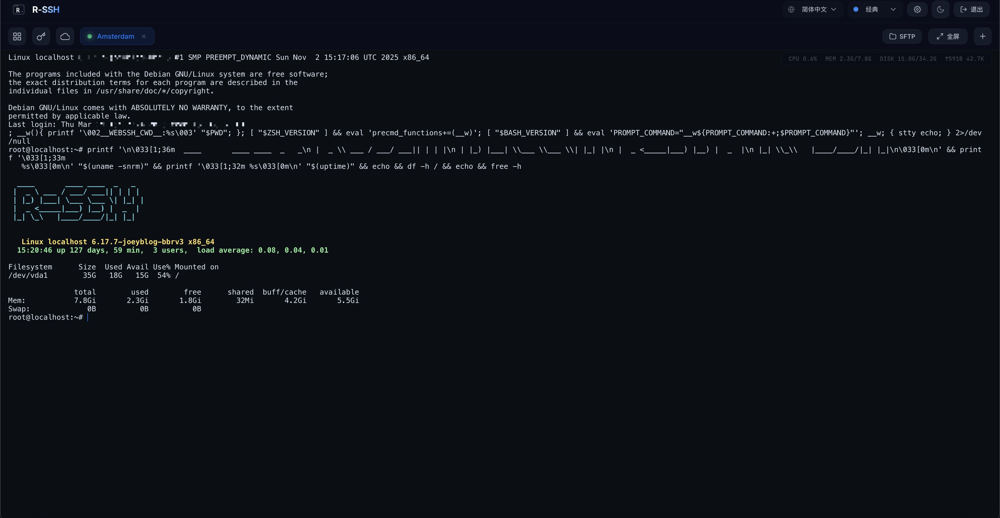

# Web SSH Terminal Guide

[简体中文](../webssh.md)

Connect to your servers from the browser. No SSH client to install.

---

## Opening and signing in

Go to `https://your-ip:9527`. The default certificate is self-signed, so the browser will warn you — continue anyway. To get rid of the warning, see [SSL Certificates](#ssl-certificate-configuration) below.

Two ways to sign in:

- **Username and password** — the `username` and `password` in `client_config`
- **Telegram code** — click "Send Code", the bot sends you a code, enter it within 60 seconds

After too many wrong passwords, password sign-in is paused for a while (up to 30 minutes). Sign in with a Telegram code instead, or restart the client to lift it right away.



---

## Layout

```
┌─────────────────────────────────────────────────────┐
│ Top bar: Language | Theme | Lightning | Settings    │
├─────────────────────────────────────────────────────┤
│                                                     │
│  Main area (switchable)      Config drawer (right)  │
│  · Host panel                                       │
│  · Terminal workspace                               │
│  · Cloud management                                 │
│  · Lightning                                        │
│                                                     │
└─────────────────────────────────────────────────────┘
```

| Area | What it is for |
|------|------|
| **Host panel** | The home page. Every server you have saved, one click to connect |
| **Terminal workspace** | The terminal once connected, with SFTP available underneath |
| **Cloud management** | Instances across your cloud accounts — see [Cloud Management Panel Guide](./cloud.md) |
| **Config drawer** | Slides in from the right when you add or edit a connection |
| **Settings menu** | SSL certificate, config files, client upgrade and logs, MCP access |

---

## Connecting

### New connection

1. On the host panel, click "Add Session" — the config drawer slides in
2. Fill in:
   - **Session name** — anything you will recognize (optional)
   - **Host** — IP or domain
   - **Port** — 22 by default
   - **Username** — the SSH user
   - **Authentication** — password or private key
3. Click "Connect"

### Authentication

| Method | Notes |
|------|------|
| **Password** | Enter the SSH password |
| **Private key** | Paste the key or pick a saved one. Enter its passphrase if it has one |

### SOCKS5 proxy

For servers you cannot reach directly, fill in a SOCKS5 proxy address and port in the config drawer.

### Host fingerprint

The first time you connect to a server you are shown its fingerprint to confirm, and it is remembered.

If you are later told the fingerprint has changed: if you reinstalled or rebuilt that server yourself, click "Clear fingerprint and reconnect" and the panel records the new one; if you have not, stop — you may not be talking to your machine.

### Quick connect

"Quick Connect" on a host card connects straight away; "Load" opens the drawer to edit the connection.

### Auto-reconnect

If the server reboots or the network drops, the terminal reconnects on its own.

After you run `exit` on the server it does not reconnect automatically; press Enter to reconnect.

### Tabs

Open as many connections as you like, one per tab. The tab bar shows the current server's CPU, memory, disk, and network usage live.



---

## Terminal toolbar

- **Favorites** — select text in the terminal and click ⭐ to save it; click it later to fill it back in
- **Search** — search the terminal output
- **Tools** — shortcuts for common admin commands
- **Split** — split the terminal in two
- **Suspend** — close the page without disconnecting, pick it up later

---

## Multi-line paste protection

Right-click pasting several lines does not run them. The block waits on the input line; press Enter once you have looked it over. Single lines still run as before.

This keeps a stray script from running the moment you paste it.

---

## Copying text in full-screen programs

In full-screen programs such as Claude Code, vim, or htop, the highlight you get by dragging is drawn by the program itself. Nothing is actually selected, so right-click copy gets nothing.

Hold Shift (Option on Mac) while dragging, then right-click to copy.

---

## Terminal image paste

When you run Claude Code or Codex in the web terminal, you can paste screenshots to them.

| Method | How |
|------|------|
| Shortcut | `Cmd+V` on Mac, `Ctrl+Shift+V` on Windows and Linux |
| Right-click | Right-click paste |
| Drag and drop | Drop an image file onto the terminal |

PNG / JPG / GIF / WebP, up to 20 MB each, several at a time.

What gets pasted is a path to the image, which Claude Code and Codex pick up as an image. Text on the clipboard still pastes as text.

---

## Split screen

Click "Split" on the toolbar to divide the terminal in two — tail a log on one side, type on the other.

- **One-click clone** — the second pane connects to the same server without re-entering anything
- **Independent** — each side is its own connection
- **Survives refresh** — the split layout comes back after reloading the page

---

## Session suspend

Like `screen`: suspend the current session, close the page, and it keeps running. Reattach later from "Suspended" with your output and running commands intact.

| Action | How |
|------|------|
| Suspend | Click "Suspend" on the toolbar |
| Reattach | Pick it from "Suspended" on the host panel |
| Split pairs | In split mode, both panes suspend and reattach together |
| Limit | Up to 20 suspended sessions per user, cleared when the client restarts |

---

## Persistent shell and alerts

- **Persistent shell** — close the browser or lose the network and the shell keeps running on the server; it reattaches when you come back
- **Resource alerts** — set CPU / memory / disk thresholds and get a Telegram message when crossed
- **Multi-cloud overview** — one page with instance counts, running and stopped, across every cloud

---

## SFTP file manager

Once connected, click "SFTP" on the tab bar and a file panel opens below the terminal. Drag the divider to resize.

| Action | Notes |
|------|------|
| **Browse** | Click into folders; the path at the top is clickable to jump back up |
| **Upload / download** | With progress |
| **Edit online** | Edit files on the server in the browser, with syntax highlighting |
| **Delete** | Files and folders; deleting a folder removes everything in it |
| **New folder** | Create a folder in the current location |

### Transfer manager

Every upload and download in one panel: progress and speed per task, cancel one or all, and a list of recently finished transfers.

### Routers work too

Devices like OpenWrt that have no SFTP support can still be browsed, uploaded to, downloaded from, and edited. The panel shows a compatibility-mode banner when that is happening.

---

## Port forwarding

Set up in the config drawer while connected.

### Local forward

Map a service on the server to a local port — for example a database that only listens on the server's localhost:

| Parameter | Example |
|------|------|
| Bind address | `127.0.0.1` |
| Bind port | `3306` |
| Target address | `127.0.0.1` |
| Target port | `3306` |

### Remote forward

The other way round: expose a local service on a port on the server.

---

## Batch commands

Send one command to several servers.

1. Tick the hosts on the host panel
2. A batch bar appears at the bottom with the selected count
3. Type the command and run it
4. Results are shown per host, with status and output for each
5. Run the next command right from the results page without reselecting

---

## Session management

### Host panel

Every saved server as a card, showing:

- Name and notes
- OS, CPU, memory, disk (detected after the first connection)
- IP (one-click copy)
- Quick connect, load, and delete buttons

Search by name or IP at the top.

### Host tags

Tag servers to group them once you have a lot:

- Type a tag on a card and press Enter to add it; click × on a tag to remove it
- Filter by tags at the top of the panel — selecting several shows only hosts carrying all of them
- The search box matches tags too

### Saving sessions

Save the connection from the config drawer after connecting; next time it is one click from the host panel. Connection details and passwords are stored encrypted.

### SSH key management

Store a private key once and every connection can use it:

- Add / delete keys
- Saved keys are tried automatically when connecting, so you do not have to pick one each time

---

## Cloud host sync

Import machines you already have on your cloud accounts into the host panel instead of typing them in.

| Platform | What is imported |
|------|----------|
| **Oracle Cloud** | IP, name, shape, region of every instance |
| **AWS** | IP, name, type, region of EC2 and Lightsail instances |
| **GCP** | IP, name, machine type, zone |
| **DigitalOcean** | IP, name, region, size of each Droplet |
| **Azure** | IP and name of each VM |
| **SolusVM** | IP of each VPS |
| **VirtFusion** | IP, name, vendor |

Click "Cloud Host Sync" at the top of the host panel. Progress is shown per cloud, and when it finishes you see how many were added and how many skipped (IPs already present are not duplicated).

Imported hosts default to port 22; set the username and key once yourself.

---

## OCI Object Storage

Manage Oracle Object Storage in the browser:

| Action | Notes |
|------|------|
| **Browse buckets** | List every bucket |
| **Browse objects** | Filter by prefix, paginate |
| **Upload / download** | Upload and download files |
| **Delete** | Delete a single file |
| **New folder** | Create a folder |

---

## SSL certificate configuration

The default self-signed certificate works, but the browser keeps warning. A Let's Encrypt certificate removes the warning, and [MCP Access](./mcp.md) requires one.

Enable ACME under Settings → SSL Certificate Settings, filling in either an IP or a domain:

| Option | Requirement |
|------|------|
| **Server public IP** | Port 80 has to be open for a few seconds while the certificate is issued |
| **Domain** | No port 80 needed, but the domain must be on Cloudflare and your Cloudflare credentials (API Token, or email + Global API Key) must be in the config file settings |

Add a notification email — Let's Encrypt sends expiry reminders there.

Renewal is automatic.

---

## Interface language

Switch between 简体中文 and English in the top bar.
