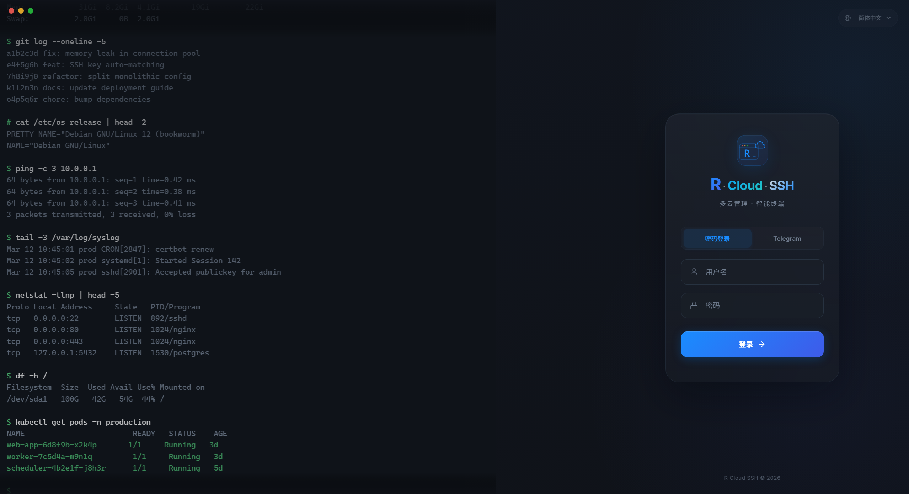
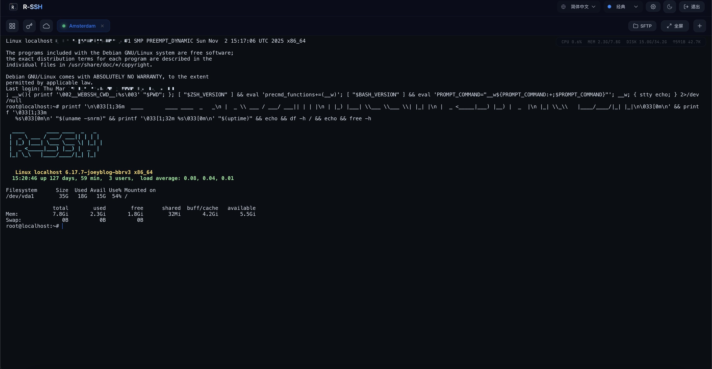

# Web SSH 终端指南

[English](./en/webssh.md)

在浏览器里连服务器，不用装任何 SSH 客户端。

---

## 打开和登录

访问 `https://你的IP:9527`。默认是自签证书，浏览器会提示不安全，点继续访问即可；想去掉这个提示，见下文 [SSL 证书](#ssl-证书配置)。

两种登录方式：

- **用户名密码** — `client_config` 里的 `username` 和 `password`
- **Telegram 验证码** — 点「发送验证码」，机器人会把验证码发给你，60 秒内输入

密码输错次数太多，密码登录会暂停一段时间（最长 30 分钟）。这时可以改用 Telegram 验证码登录，或者重启客户端立即解除。



---

## 界面

```
┌─────────────────────────────────────────────────────┐
│ 顶部栏：语言 | 主题 | 闪电 | 设置 | 登出             │
├─────────────────────────────────────────────────────┤
│                                                     │
│  主内容区（切换）             配置抽屉（右侧滑出）  │
│  · 主机面板                                         │
│  · 终端工作区                                       │
│  · 云管理面板                                       │
│  · 闪电权益                                         │
│                                                     │
└─────────────────────────────────────────────────────┘
```

| 区域 | 用途 |
|------|------|
| **主机面板** | 登录后的首页，所有保存过的服务器都在这里，点一下就连 |
| **终端工作区** | 连上之后的终端界面，下方可以打开 SFTP 传文件 |
| **云管理面板** | 管理各家云的实例，见 [Web 云管理面板指南](./cloud.md) |
| **配置抽屉** | 新建或编辑连接时从右侧滑出，填 IP、账号、密码等 |
| **设置菜单** | SSL 证书、配置文件、客户端升级与日志、MCP 接入 |

---

## 连接服务器

### 新建连接

1. 主机面板点「添加会话」，右侧滑出配置抽屉
2. 填写：
   - **会话名称** — 随便起，方便自己认（可不填）
   - **主机** — IP 或域名
   - **端口** — 默认 22
   - **用户名** — SSH 登录用户
   - **认证方式** — 密码或私钥
3. 点「连接」

### 认证方式

| 方式 | 说明 |
|------|------|
| **密码** | 输入 SSH 密码 |
| **私钥** | 粘贴私钥，或选一个已保存的密钥。私钥有密码的一并填上 |

### SOCKS5 代理

直连不通的服务器可以走 SOCKS5 代理，在配置抽屉里填代理地址和端口。

### 主机指纹

第一次连某台服务器时会弹出它的指纹让你确认，确认后记下来。

以后如果提示指纹变了：是你自己重装或重建过这台服务器的，点「清除指纹并重连」，面板会记下新指纹；没有重装过就先别连 —— 连到的可能不是你的机器。

### 快速连接

主机卡片上点「快速连接」直接连；点「加载」可以打开配置抽屉修改连接信息。

### 断线自动重连

服务器重启或网络抖动断开后，终端会自己重连，不用手动操作。

在服务器上执行 `exit` 退出后不会自动重连，按回车可以重新连接。

### 多标签页

可以同时开多个连接，每个一个标签页。标签栏上实时显示当前服务器的 CPU、内存、硬盘、网络占用。



---

## 终端工具条

- **收藏** — 在终端里选中一段文字点 ⭐ 存下来，之后一键填回终端
- **搜索** — 搜索终端里的输出内容
- **工具栏** — 常用运维命令快捷入口
- **分屏** — 当前终端一分为二
- **挂起** — 关掉页面也不断开，下次接着用

---

## 多行粘贴保护

右键粘贴多行内容时不会直接执行，整段停在输入行，看一眼没问题再按回车。单行粘贴照常直接执行。

防的是误粘一整段脚本进去直接跑起来。

---

## 在全屏程序里复制文字

在 Claude Code、vim、htop 这类全屏程序里，直接拖出来的高亮是程序自己画的，并没有真的选中，右键复制不到东西。

按住 Shift（Mac 按 Option）再拖选，然后右键复制。

---

## 终端贴图

在网页终端里跑 Claude Code、Codex 时，也能直接粘截图给它们。

| 方式 | 操作 |
|------|------|
| 快捷键 | Mac `Cmd+V`，Windows 和 Linux `Ctrl+Shift+V` |
| 右键 | 右键粘贴 |
| 拖放 | 把图片文件拖进终端 |

支持 PNG / JPG / GIF / WebP，单张不超过 20MB，可以一次粘多张。

粘进去的是一个图片路径，Claude Code、Codex 会自动把它识别成图片。剪贴板里是文字时照常按文字粘贴。

---

## 终端分屏

工具条点「分屏」，终端左右一分为二，一边看日志一边敲命令。

- **一键克隆** — 第二个面板自动连上同一台服务器，不用重填
- **互不影响** — 两边各是一个独立连接
- **刷新还原** — 刷新页面后分屏布局还在

---

## 会话挂起

类似 `screen`：把当前会话挂起，关掉页面它也不断，下次从「已挂起」里接回来，之前的输出和正在跑的命令都在。

| 操作 | 说明 |
|------|------|
| 挂起 | 工具条点「挂起」 |
| 接回 | 主机面板的「已挂起」入口里选 |
| 分屏整组挂起 | 分屏状态下两个面板一起挂、一起接回 |
| 数量限制 | 每人最多 20 个挂起会话，客户端重启后清空 |

---

## 持久 Shell 与告警

- **持久 Shell** — 浏览器关了或网断了，服务器上的 shell 还在跑，下次打开自动接回
- **资源告警** — 给 CPU / 内存 / 磁盘设阈值，超了发 Telegram
- **多云体检** — 一个页面看所有云的实例总数、运行和停止数量

---

## SFTP 文件管理

连上服务器后点标签栏的「SFTP」，终端下方会出现文件面板，中间的分隔条可以拖动调整高度。

| 操作 | 说明 |
|------|------|
| **浏览目录** | 点文件夹进入，顶部路径可以点击快速跳回上级 |
| **上传 / 下载** | 显示进度 |
| **在线编辑** | 直接在浏览器里改服务器上的文件，带语法高亮 |
| **删除** | 文件和文件夹都能删，文件夹会连同里面的内容一起删 |
| **新建目录** | 在当前位置建文件夹 |

### 传输管理器

所有上传下载集中在一个面板里，能看到每个任务的进度和速度，可以取消单个或全部，也能看最近完成的记录。

### 路由器也能传文件

OpenWrt 这类没有 SFTP 功能的设备，文件面板照样能浏览、上传、下载、编辑。面板顶部会提示当前处于兼容模式。

---

## 端口转发

连接状态下在配置抽屉里设置。

### 本地转发

把服务器上的服务映射到本地端口，比如访问服务器上只对本机开放的数据库：

| 参数 | 示例 |
|------|------|
| 绑定地址 | `127.0.0.1` |
| 绑定端口 | `3306` |
| 目标地址 | `127.0.0.1` |
| 目标端口 | `3306` |

### 远程转发

反过来，把本地的服务暴露到服务器的端口上。

---

## 批量命令

同一条命令发给多台服务器。

1. 主机面板勾选要操作的主机（可多选）
2. 底部出现批量操作栏，显示已选数量
3. 输入命令，点执行
4. 结果按主机分开显示，每台的状态和输出都能看到
5. 可以直接在结果页接着执行下一条，不用重新选主机

---

## 会话管理

### 主机面板

所有保存过的服务器以卡片形式列出，每张卡片显示：

- 名称和备注
- 系统、CPU、内存、硬盘（连过一次后自动识别）
- IP（可一键复制）
- 快速连接、加载配置、删除按钮

顶部可以按名称、IP 搜索。

### 主机标签

给服务器打标签分组，机器多了好找：

- 在卡片上输入标签名回车即添加，点标签上的 × 删除
- 面板顶部点标签筛选，选多个标签时只显示同时带这些标签的主机
- 搜索框也能搜标签

### 保存会话

连接成功后在配置抽屉里保存，下次主机面板上点一下就连。连接信息和密码加密保存。

### SSH 密钥管理

私钥在这里存一次，之后所有连接都能选它：

- 添加 / 删除密钥
- 连接时会自动试用已保存的密钥，不用每次手选

---

## 云主机同步

云上已经有的机器，一键导入到主机面板，不用一台台手填。

| 平台 | 导入内容 |
|------|----------|
| **Oracle Cloud** | 所有实例的 IP、名称、规格、区域 |
| **AWS** | EC2 和 Lightsail 实例的 IP、名称、机型、区域 |
| **GCP** | 实例的 IP、名称、机型、可用区 |
| **DigitalOcean** | Droplet 的 IP、名称、区域、规格 |
| **Azure** | 虚拟机的 IP 和名称 |
| **SolusVM** | VPS 的 IP |
| **VirtFusion** | 实例的 IP、名称、厂商 |

操作：主机面板顶部点「云主机同步」，页面会显示每家云的查询进度，完成后告诉你新增了几台、跳过了几台（已经存在的 IP 不会重复导入）。

导入的主机默认端口 22，用户名和密钥还需要自己配一次。

---

## OCI 对象存储

在浏览器里管理甲骨文的对象存储：

| 操作 | 说明 |
|------|------|
| **浏览 Bucket** | 列出所有存储桶 |
| **浏览文件** | 支持按前缀筛选和分页 |
| **上传 / 下载** | 上传和下载文件 |
| **删除** | 删除单个文件 |
| **新建文件夹** | 创建目录 |

---

## SSL 证书配置

默认是自签证书，能用但浏览器会一直提示不安全。换成 Let's Encrypt 正式证书后提示消失，[MCP 接入](./mcp.md) 也必须用正式证书。

在「设置 → SSL 证书设置」开启 ACME 自动签发，IP 和域名二选一填：

| 方式 | 条件 |
|------|------|
| **填服务器公网 IP** | 签发时需要临时开放 80 端口几秒钟 |
| **填域名** | 不用开 80 端口，但要先在配置文件设置里填好 Cloudflare 凭据（API Token 或邮箱 + Global API Key），域名要托管在 Cloudflare |

再填一个通知邮箱，Let's Encrypt 会往这里发过期提醒。

签发后自动续期，不用管。

---

## 界面语言

顶部栏切换简体中文 / English。
